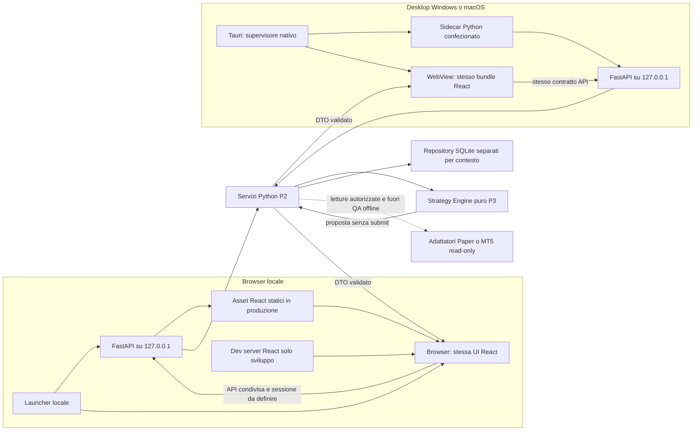

# Architettura applicativa — decisioni QA per browser e desktop

## Persistenza UI — 17 novembre, follow-up

Il file locale-v1-ui-preferences.json vive nello stesso app-data esplicito del
servizio, separato dai ledger e contiene solo tema/densità/larghezza. GET è
senza effetti collaterali; POST protetto, schema chiuso e sostituzione atomica.
Il browser non considera localStorage durevole tra porte. Nessuna migrazione
DB, formula finanziaria o autorità broker aggiunta. Per contratti ed errori
vedere BACKEND_HANDOFF; comportamento UI in DASHBOARD_HANDOFF.

## Consolidamento del contratto v1 — missione 17 novembre

Schemas Pydantic di risposta aggiunti tra servizi e consumerReact; SDKnormalizzato
in JSON, senza nuove formule o autorità di esecuzione.503generico su output
invalido, idempotenza mantenuta. Pannelli usano preferenza UI e CSSvariables,
nessun cambiamento del flussoPython o dei confini di contabilità. Branch dedicato
master-consolidation-20261117 sopra a6d3f60; nessun merge main o modifica branchowner.

> **Fotografia corrente, 17 novembre 2026:** l'architettura descritta come target
> nella baseline storica sotto è implementata nel candidato `a6d3f60` (PR #8
> sopra #7). Browser e desktop condividono React/API; il backend nuovo non
> autorizza ordini broker. Dettagli correnti: [audit](MASTER_AUDIT.md),
> [20 gate](RELEASE_GATES.md), [verbale Windows 11](END_TO_END_QA_PLAN.md).
> La separazione di un checkout non separa l'app-data desktop: per il collaudo
> Windows serve un profilo/dati di prova effettivamente isolato. Nessuna nuova
> decisione sulle interfacce o modifica dei componenti degli owner in questa fase.

Missione unica December QA & Release, direttiva prioritaria Notion del
16 novembre 2026. Documento decisionale **proposto**, non implementazione
o contratto già accettato da P1/P2/P3. Owner della verifica: Persona 4.
Base ispezionata: `3df4f8260fcbb85ea8ccf2c2b680f672adc89af4` (BASE).
Data/ambiente: 16 novembre 2026, sessione iniziata 11:55:10 UTC / 12:55:10
Europe/Rome, macOS 27.2.1 arm64. Nessun candidato migrato identificato dal responsabile.

## 1. Situazione reale, distinta dal target

| Componente | Evidenza statica alla BASE | Limite |
| --- | --- | --- |
| Dashboard | `app.py`, `src/ui/`: Streamlit; [handoff storico](../DASHBOARD_HANDOFF.md) | Non è la UI React richiesta |
| Console HTTP | `main.py:23-43`, `ui/control_box.py:123-187`: FastAPI, HTML locale, stato/controlli/comandi | Non è un contratto completo della nuova API P2 |
| Ciclo di vita legacy | `create_app` inizializza runtime e avvia worker al lifespan; `main.py` legge configurazione da `.env` | Non avviato: non assumere avvio innocuo o equivalente al launcher nuovo |
| Sessione legacy | token effimero in `create_app`, inserito nell'HTML; scritture richiedono header, GET stato no | Non certifica il requisito nuovo di sessione/token fuori dal frontend |
| Engine | `StrategyEngine.evaluate` e `SignalProposal.to_dict` esistenti | Caller deve conservare ID, metadati e rivalidare; nessun consumer React/API completo |
| Broker | Alpaca Paper, gate dati e coordinatore già presenti | Snapshot sequenziali, storico limitato a 500; saturazione rifiutata, non paginazione completa |
| React/Tauri/MT5 | Nessun manifest React, Cargo/Tauri o modulo MT5 nei tree dei branch esaminati | Build e runtime nuovi BLOCKED, non test falliti |
| Licenze/build | Pin diretti nei requirements; nessun lock React/Rust o inventario licenze distribuzione nel tree | Reproducibilità transitiva, obblighi e costi NON VERIFICATI |

Non modificare i moduli legacy per adattarli al piano. Non usare la console
Omega come backend del prodotto senza una consegna P2 verificata.

## 2. Flussi target e confini di processo

Le frecce seguenti sono il target della direttiva, non processi avviati.
Un unico bundle React e un unico contratto API devono servire le due modalità.

La catena di proposta è **P3 → P2 API → P1 UI**. Nessun import di UI/API/broker
deve entrare nel motore puro. L'API non trasforma la proposta in ordine implicito;
le autorizzazioni e i controlli esecutivi esistenti restano obbligatori.
I nodi servizi/engine/repository rappresentano moduli riusati, non un database
o capitale condiviso fra contesti. Ogni istanza possiede le proprie risorse.
Se browser e desktop usano lo stesso conto Paper, devono rispettare lo stesso
coordinatore/account e journal verificato: due sidecar non possono creare due
autorità indipendenti. Senza coordinamento valido gli invii restano disabilitati.
Il launcher browser non è un server pubblico o un tunnel. In produzione gli
asset sono locali: nessun dev server/CDN necessario per le funzioni locali.

## 3. Decisioni da confermare e contratti di consegna

Ownership target indicata dalla direttiva: P1 UI React/shell desktop; P2 API,
servizi e adattatori; P3 strategie; P4 audit e QA. I vecchi branch storici
backend/dashboard mantengono i propri nomi: non dedurne l'ownership nuova.
Questa tabella registra dipendenze, non assegna nuovi task.

| ID | Decisione/contratto necessario | Evidenza richiesta | Stato |
| --- | --- | --- | --- |
| A01 | Una UI React e una API per browser e Tauri | SHA bundle, OpenAPI/schema versionato, adapter UI e test contratto identici | BLOCKED: non consegnati |
| A02 | Supervisore unico del sidecar per istanza e contesto | PID/handle di proprietà, socket acquisito senza gara, identità istanza e lifecycle | BLOCKED |
| A03 | Sessione locale senza token in frontend/URL/CLI | Protocollo bootstrap documentato, threat review e test negativi | BLOCKED: scelta non risolta qui |
| A04 | Envelope dati/rischio | Context/account/symbol/UTC/source/quality/as_of/completeness/error preservati; numeri finiti, null distinti da zero | Da concordare con P2/P3 |
| A05 | Contratto proposte | Campi reali `SignalProposal.to_dict`, expiry/ID e motivazioni; nessun framework nel motore | Motore storico ispezionato, nuovo adapter BLOCKED |
| A06 | Contratto MT5 read-only | Stati unsupported/unavailable/unverified/connected/stale, whitelist letture, nessuna scrittura | BLOCKED: adattatore assente |
| A07 | Pacchetto Python per OS/architettura | Entrypoint innocuo, runtime incluso, dipendenze/licenze/hash e artifact nativo | BLOCKED |

Non inventare endpoint o versioni come già stabili: il futuro health endpoint e
le route applicative richiedono schema P2. Il GET legacy `/api/state` e i POST
`/api/controls` e `/api/command` non costituiscono tale schema.
La UI mostra N/D e motivo su assenza/errore, non vecchio saldo verificato.
Metadati DataFrame e quote vanno serializzati e conservati nell'API, non persi
convertendo solo i prezzi in JSON. L'API riusa `select_completed_bars` e i
controlli originali; non replica un gate permissivo.

### Sessione: decisione aperta esplicita

Il requisito vieta segreti in bundle/frontend, log, URL e argomenti CLI.
Un bearer inserito nell'HTML o localStorage non soddisfa questa scelta.
Per il desktop valutare token solo nel supervisore/backend e ponte nativo
ristretto; per il browser serve un bootstrap sicuro della sessione da concordare.
Cookie HttpOnly/SameSite e controlli CSRF sono opzioni da verificare, non una
soluzione implementata o sufficiente da sola. Nessun token esemplificativo reale
o canale URL viene introdotto dal documento. Senza protocollo approvato: STOP.

## 4. Lifecycle richiesto, da provare su ciascun OS

| Fase | Risultato richiesto | Prova negativa |
| --- | --- | --- |
| Start | Il supervisore avvia solo il proprio eseguibile, acquisisce il bind 127.0.0.1 e attende readiness autenticata | Porta occupata, binario assente/alterato, seconda istanza: nessun collegamento al processo sbagliato |
| Health | Stato starting/ready/error distinto; non espone conto/segreti e non avvia trading | Backend vivo ma servizi non pronti, versione contratto diversa |
| Timeout | Deadline di avvio/health/stop finite e concordate, UI in errore esplicito | Worker lento o bloccato: niente retry di mutazioni o stato falsamente connesso |
| Crash | Invalidazione di snapshot/sessione, automazione arrestata, nessun reinvio ambiguo | Crash dopo ack perso: riconciliazione richiesta, non replica dell'ordine |
| Shutdown | Arresto ordinato, chiusura worker/SQLite e rilascio delle sole risorse possedute | Timeout: terminare solo il proprio processo dopo la policy concordata; non kill per porta/nome |
| Cleanup/restart | Nessun orfano/socket/lock; journal incerto conservato; token vecchio revocato | Non cancellare DB/journal per far ripartire; verificare riconciliazione prima di sbloccare |

Le deadline numeriche, l'identità handshake e la policy di singola istanza
devono essere esplicite nel contratto consegnato; non sono dedotte dal legacy.

## 5. Security boundary da accettare

- Solo `127.0.0.1`; nessun `0.0.0.0`, LAN o inoltro pubblico. Porta appartenente
  al processo verificato, non semplice ricerca di una porta libera poi riaperta.
- Host e Origin esatti per produzione/dev/WebView, con porta e schema dove
  necessari; host di test confinati ai test. Origin assente/ostile va gestito
  esplicitamente; non fidarsi di localhost o del fatto che il client sia locale.
- CORS con allowlist minima; niente wildcard con credenziali. CORS non sostituisce
  autenticazione, controllo Origin o protezione CSRF sulle mutazioni.
- Token effimero associato a istanza/sessione, mai credenziale broker; bootstrap
  A03 e revoca al riavvio. Dati conto protetti anche in lettura. Niente segreti
  in bundle, storage frontend, log/traceback, URL, querystring o CLI.
- Capabilities Tauri ristrette a finestra e funzioni necessarie: niente shell
  arbitraria, filesystem globale o URL remoti con permessi nativi. Audit anche
  dei comandi custom, non solo dei plugin. CSP e navigazione WebView da verificare.
- SQLite in directory applicative distinte e UTF-8/pathlib; test con spazi,
  Unicode, alias/hard link e file temporanei. SQLite non è un deposito implicito
  di chiavi: credential store eventuale richiede contratto e consenso separati.
- I test offline usano transport/broker mock e contano socket/credenziali. Nessun
  ordine, feed reale, terminale MT5 o `.env` personale è necessario per il QA locale.

## 6. Contesti e compatibilità

| Contesto | Capitale/ledger | Dati e autorizzazioni | Limite |
| --- | --- | --- | --- |
| Demo | Proprio, sintetico dichiarato | Nessun SDK broker | Mai fallback silenzioso di un errore reale |
| Simulazione | SQLite dedicato, indipendente | Dati con provenienza esplicita; esecuzione solo locale | Nessun saldo/posizione importato da Paper |
| Alpaca Paper | Solo snapshot conto Paper e journal distinto | Verifica dati, rischio, coordinatore e riconciliazione | Default fermo; nuova API non concede permessi aggiuntivi |
| MT5 | Stato/account/permessi isolati; nessun capitale condiviso | Solo letture autorizzate su Windows; `order_send` e altre scritture vietati | Su macOS unsupported, niente emulazione o valori fittizi |

Terminale MT5 assente e account non verificato non sono connected. Connessione
non garantisce freschezza; dopo timeout i dati diventano stale/unavailable.
Prova autentica solo su Windows con terminale/account dell'utente e consenso
esplicito, senza inviare ordini. Non chiedere password in chat o Notion.

## 7. Packaging, offline, licenze e costi

Target: stesso bundle React, backend Python confezionato per Windows x64 e
macOS per le architetture dichiarate. Architetture non provate restano NON
VERIFICATE; un artifact arm64 non prova Intel. PyInstaller è un'opzione, non
una dipendenza installata né un formato già scelto. Sidecar Tauri e nome target
devono corrispondere all'artifact prodotto. Build e smoke d'installazione su
runner/host nativi distinti, con SHA, toolchain, comandi, hash artifact e output.

Provare installazione su macchina senza Python/Node globali, percorso con spazi,
avvio offline, chiusura/crash e cleanup. Funzioni locali senza internet, servizi
feed/broker esplicitamente indisponibili; nessun download CDN/runtime automatico
silenzioso. Prerequisiti WebView e installer offline vanno documentati per OS.
Firma/notarizzazione e relativi costi sono NON VERIFICATI; non bypassare avvisi OS.

Richiesti inventario/SBOM e licenze delle versioni realmente distribuite,
obblighi di notice/source, lock e hash transitive Python/JS/Rust. I pin Python
diretti osservati non attestano riproducibilità completa. Nessuna certificazione
di licenze o assenza di canoni deriva dall'uso di tool OSS. Nessun SaaS deve
essere obbligatorio per il core locale; costi/termini di broker, feed, firma e
servizi opzionali vanno verificati separatamente. Non introdotti servizi o acquisti.

## 8. Fonti e prossimo gate

Fonti primarie consultate il 16 novembre 2026; Context7 non disponibile
(Unknown tool), usata documentazione ufficiale, non installate librerie:

- [Tauri sidecar](https://v2.tauri.app/develop/sidecar/): packaging per target.
- [Tauri capabilities](https://v2.tauri.app/security/capabilities/): limiti di permessi.
- [FastAPI CORS](https://fastapi.tiangolo.com/tutorial/cors/): origini esplicite.
- [PyInstaller](https://pyinstaller.org/en/stable/operating-mode.html): artifact specifico di OS/runtime.

Queste fonti non provano che il progetto abbia già implementato il target.
Prossimo gate: ricevere SHA/report/contratti P1/P2/P3 e candidato integrato dal
responsabile; applicare l'unico [piano QA](END_TO_END_QA_PLAN.md) e
[release gates](RELEASE_GATES.md). Readiness del nuovo prodotto: **BLOCKED**.

## Consolidamento verificato — branch completion, 16 novembre

Il diagramma browser/desktop precedente è ora implementato alla base37a3840.
Gli stati BLOCKED della ricognizione iniziale restano storici. La nuova API
riusa un solo ledger per contesto e gli stessi engine/controlli di rischio.
`OfflineExecutor` è un diario di controllo, non un secondo ledger né un adapter
broker: comandi idempotenti, lockOS per contesto, eventi e intent persistenti.
Le riconciliazioni Python confrontano snapshot sintetici completi con saldo e
posizioni attesi forniti dal chiamante; non ricostruiscono contabilità autentica.
L’API espone soltanto il dry-run locale. MT5ReadOnly resta il validatore nel figlio
spawn; MT5Process nel padre applica deadline allo scambio e invalida errori.
Le capability Tauri restano vuote, l’origine è esclusivamente127.0.0.1.
